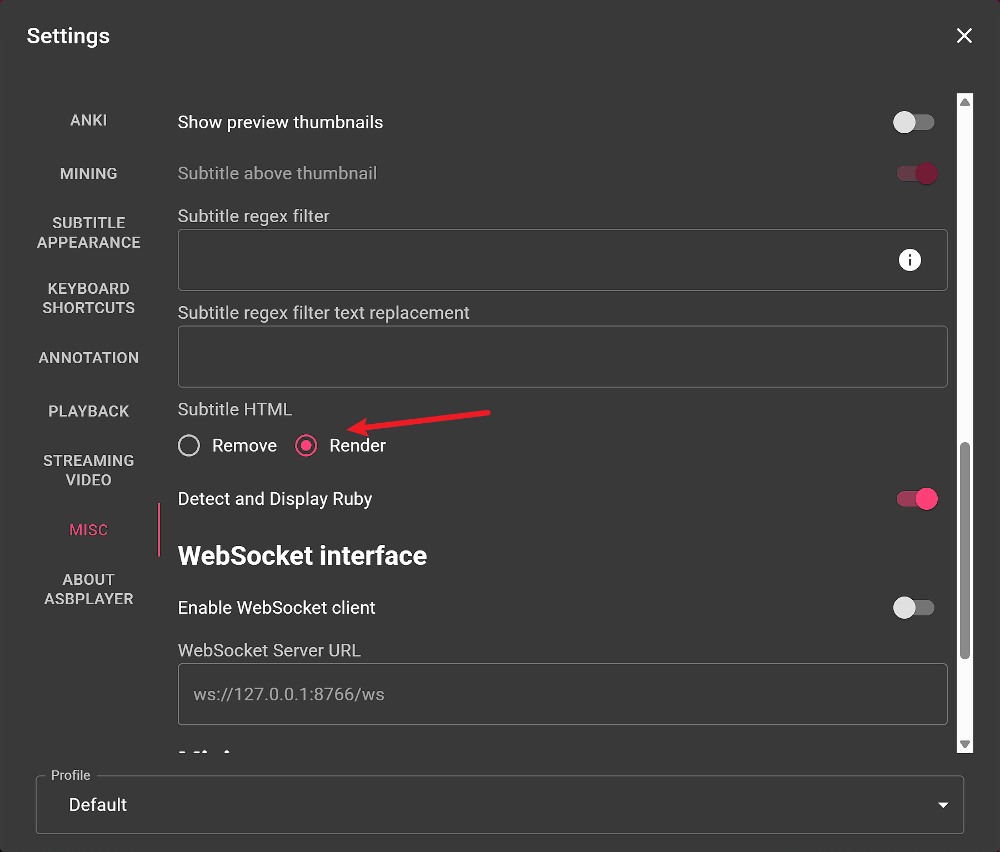
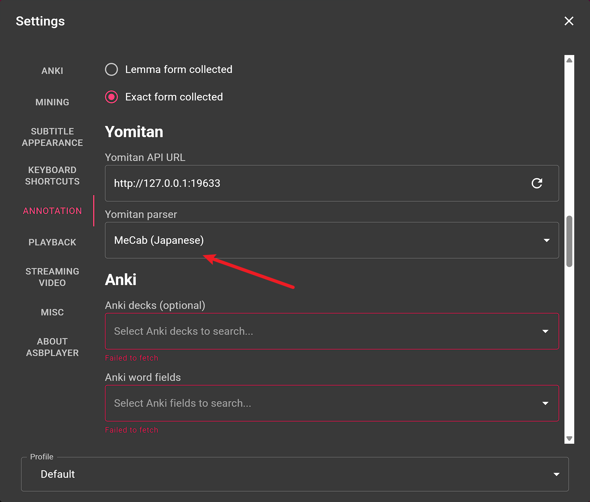
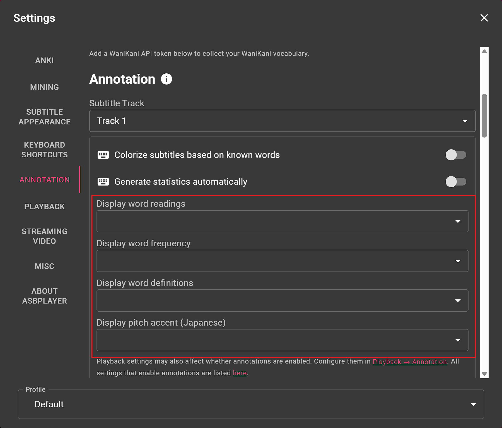

# EasyFuriSub — 轻量日语字幕注音工具

把 SRT / ASS 字幕批量转成 **VTT 字幕**，并用 `pykakasi` 自动给汉字加上假名注音（`<ruby>` 标签），适合用 `asbplayer`/`potplayer`等可以加载.vtt字幕的 看日剧 / 动漫的日语学习者。

## 图片示例 
原字幕：
<p align="center"></p>

转换后字幕:
<p align="center"></p>
- 字幕来源 :[Jimaku](https://jimaku.cc/),
- 视频: [名侦探柯南：第110话 窃盗集团别墅事件（上集）](https://www.bilibili.com/bangumi/play/ep321917/?share_source=copy_web)
## 字幕示例

转换前（SRT）：

```srt
18
00:02:11,131 --> 00:02:15,177
“そこに越した矢先に
不思議な出来事が毎日 続き—”
```

转换后（VTT）：

```vtt

00:02:11.131 --> 00:02:15.177
“そこに<ruby>越し<rt>こし</rt></ruby>た<ruby>矢先<rt>やさき</rt></ruby>に
<ruby>不思議<rt>ふしぎ</rt></ruby>な<ruby>出来事<rt>できごと</rt></ruby>が<ruby>毎日<rt>まいにち</rt></ruby> <ruby>続き<rt>つづき</rt></ruby>—”
```

在支持 HTML 渲染的播放器 / asbplayer 中，汉字上方会显示小字假名注音。

## 功能特性

- 输入：`.srt` / `.ass`（ASS 自动解析 `[Events]` 段，剥离特效标签，跳过 Comment 行）
- 输出：`.vtt`（汉字自动注音，假名、标点保持原样）
- 两种模式：**批量处理**（扫描文件夹内全部 `*.srt` / `*.ass`）/ **单个文件**
- 图形界面，带日志输出与文件名前缀设置
- 已打包 exe，**无需安装 Python**

## 注音精准度说明

注音由 `pykakasi` 基于日文读音字典自动生成，**不结合上下文语义判断**，以下情况可能出现注音不准：

- **多音字**：如「人」可能注为 ひと / じん / にん，取的是字典默认读音
- **专有名词**：人名、地名、作品名的特殊读法无法识别
- **数字**：按默认读法注音，实际台词中可能有其他读法

生成结果**仅供参考，请以实际台词读音为准**。发现注音错误时，可以用文本编辑器直接打开生成的 `.vtt` 文件，修改对应 `<rt>` 标签里的假名即可。

## 快速开始

### 使用 exe（推荐）

下载并运行 `gui_subtitle2vtt.exe`：

1. 选择处理模式：批量处理（文件夹）/ 单个文件
2. 选择输入路径（文件夹或字幕文件）和输出文件夹
3. （可选）设置文件名前缀，默认 `ruby_`
4. 点击「开始转换」，在输出文件夹得到 `*.vtt`

### 从源码运行

```bash
pip install pykakasi
python subtitle2vtt/gui_subtitle2vtt.py
```

## 配合 asbplayer 使用注意事项

VTT 的 `<ruby>` 注音需要 asbplayer 以 HTML 渲染字幕才能生效.经过我的摸索, 若您的asbplayer不能正常显示注音,请参考以下设置：

1. **asbplayer 中`Misc`中**,
Subtitle HTML选项要开启 `Render`（渲染），否则 ruby 标签会以纯文本形式显示
2. **asbplayer 的 annotation 中**
`Yomitan parser`要选 `mecab`——即使不使用 annotation 功能也要选
3. 使用 asbplayer 的 annotation（注解）功能时，需要在 Yomitan 中关闭以下显示项：
   - Display word readings
   - Display word frequency
   - Display word definitions
   - Display pitch accent (Japanese)
4. 尝试开启`Misc`中的`Detect and Display Ruby`

设置参考截图：

<p align="center"></p>

<p align="center"></p>

<p align="center"></p>

## 开发与打包

```bash
pip install pyinstaller pykakasi
pyinstaller subtitle2vtt/gui_subtitle2vtt.spec --noconfirm
```

⚠️ 打包必须保留 `--collect-all pykakasi`（日文读音字典数据文件不会被自动收集），遇到 `pathlib backport` 报错时卸载 PyPI 的 pathlib 即可。

## 目录结构

| 路径 | 说明 |
| --- | --- |
| `subtitle2vtt/` | 主程序：GUI 源码（gui_subtitle2vtt.py）、打包配置（.spec）、成品 exe |
| `example/` | 示例字幕：example.srt / example.ass 输入与 example.vtt 转换效果 |
| `image-*.png` | README 截图 |

## 致谢

- [pykakasi](https://github.com/miurahr/pykakasi) — 日文假名注音
- [asbplayer](https://github.com/killergerbah/asbplayer) — 浏览器字幕插件
- [Yomitan](https://github.com/themoeway/yomitan) — 划词词典
